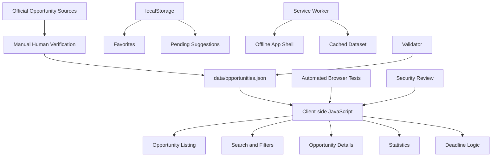

# Yemen Opportunities Portal — Project Documentation

> Comprehensive technical and product documentation for the Yemen Opportunities Portal.

## 1. Project Overview

**Yemen Opportunities Portal** is a bilingual Arabic/English web application created to help Yemeni students and youth discover reliable education and career opportunities from official sources.

The portal brings together verified scholarships, internships, fellowships, free online courses, and professional training opportunities in one lightweight, mobile-friendly interface.

The project is intentionally built as a static application with no backend requirement, no runtime CDN dependencies, no automatic scraping, and no automatic production-data mutation.

### Core Principle

Opportunity data is not generated automatically and is not scraped from the web. Every production opportunity is manually collected and verified against an official source before it is included in the production dataset.

---

## 2. Problem Statement

Students and young professionals in Yemen often discover scholarships, internships, and training opportunities through fragmented social media posts, forwarded messages, unofficial groups, or outdated websites.

This creates several problems:

- Opportunity information is scattered across many platforms.
- Deadlines may be outdated or unclear.
- Unofficial posts may omit eligibility requirements.
- Users may struggle to distinguish trustworthy opportunities from unreliable ones.
- Opportunities are often presented only in English.
- Limited or unstable internet connectivity can make repeated browsing difficult.

The Yemen Opportunities Portal addresses these problems by providing one organized, bilingual interface built around official-source verification and simple client-side access.

---

## 3. Target Users

The primary audience includes:

- Yemeni university students
- High-school graduates seeking undergraduate opportunities
- Undergraduate students seeking scholarships or internships
- Graduate students seeking Master's or PhD opportunities
- Fresh graduates
- Young professionals seeking free courses and professional development
- Users who prefer Arabic-language interfaces
- Users with limited or intermittent internet access

The portal does **not** guarantee eligibility for any opportunity. Users are always directed to the official source for final requirements and application decisions.

---

## 4. Project Objectives

The project aims to:

1. Centralize high-quality opportunities relevant to Yemeni youth.
2. Use official sources instead of unverified reposts.
3. Provide full Arabic and English interfaces.
4. Make opportunity discovery fast through search and filtering.
5. Make deadlines easier to understand.
6. Allow users to save favorites locally.
7. Continue providing the core experience after the first successful online load.
8. Preserve user privacy by avoiding unnecessary account creation or data collection.
9. Keep the application lightweight and dependency-free.
10. Provide reproducible testing, security review, and deployment evidence.

---

## 5. User Stories

### US-01 — Search

As a user, I can search opportunities using Arabic or English keywords so that I can quickly find relevant opportunities.

### US-02 — Filters

As a user, I can filter opportunities by relevant criteria such as type, country, field/category, and education level.

### US-03 — Deadline Awareness

As a user, I can understand whether an opportunity has a fixed deadline, an approaching deadline, a rolling deadline, or no clearly stated deadline.

### US-04 — Opportunity Details

As a user, I can open a detailed opportunity view containing title, organization, deadline, official source, verification information, eligibility notes, description, and related metadata.

### US-05 — Favorites

As a user, I can save opportunities to favorites and keep those selections across page reloads using local browser storage.

### US-06 — Mobile Experience

As a user, I can use the portal comfortably on a 360px-wide mobile viewport without unintended horizontal scrolling.

### US-07 — Offline After First Load

As a user, I can continue accessing the cached core portal experience after the application has successfully loaded online at least once.

---

## 6. Product Scope

### Included

- Bilingual Arabic/English interface
- RTL/LTR direction switching
- Opportunity listing
- Search
- Filters
- Opportunity detail pages
- Favorites
- Deadline states
- Statistics dashboard
- About page
- Opportunity suggestion form
- Offline service-worker support
- Local browser persistence
- Human-verified production dataset
- Automated validation
- Automated browser regression tests
- Security review evidence
- Weekly read-only maintenance reporting
- GitHub Pages deployment workflow

### Out of Scope

The current version intentionally does not include:

- User accounts
- Login or authentication
- Applying to opportunities on behalf of users
- Automated scraping
- Automatic modification of production opportunity data
- Automatic acceptance of user-submitted opportunities
- Collection of sensitive personal information
- Guaranteed scholarship or internship eligibility
- Backend database infrastructure
- Automatic AI-generated opportunity records

---

## 7. Architecture

The application uses a static client-side architecture.



### Architectural Characteristics

- Static HTML/CSS/JavaScript
- No backend server required
- No runtime CDN
- No runtime package dependency
- Same-origin application assets
- Client-side JSON dataset
- Local browser persistence
- Progressive offline caching

---

## 8. Technology Stack

### Frontend

- HTML5
- CSS3
- Vanilla JavaScript

### Data

- JSON production dataset
- JSON schema
- Metadata-rich opportunity records

### Browser Storage

- `localStorage` for favorites
- `localStorage` for pending opportunity suggestions

### Offline

- Service Worker
- Cache Storage API

### Validation and Testing

- Node.js-compatible validation scripts
- Chrome DevTools Protocol browser tests
- Deterministic acceptance/regression tests

### Version Control and Deployment

- Git
- GitHub
- GitHub Actions
- GitHub Pages

No JavaScript framework, CSS framework, package manager dependency, CDN, or external runtime library is required by the production portal.

---

## 9. Main Pages

### `index.html`

The main opportunity discovery page.

Responsibilities:

- Load the production opportunity dataset
- Display opportunity cards
- Search
- Filters
- Results count
- Deadline badges
- Language switching
- Navigation
- Empty-state handling

### `detail.html`

Displays the full details of a selected opportunity.

Responsibilities:

- Opportunity metadata
- Organization
- Deadline
- Official source
- Eligibility
- Verification information
- Favorite control
- Safe external-link handling

### `statistics.html`

Provides a data-driven overview of the production dataset. The dashboard is generated from the current production data rather than hard-coded totals.

### `suggest.html`

Allows users to prepare a local opportunity suggestion.

Important behavior:

- Suggestions are stored locally.
- Suggestions receive a pending state.
- Suggestions are **not** merged automatically into production data.
- Human review remains mandatory.

### `about.html`

Explains the purpose, methodology, data principles, and scope of the portal.

---

## 10. Production Dataset

The production dataset is stored in:

`data/opportunities.json`

### Final Production Size

**50 opportunity records**

### Opportunity Distribution

The dataset contains:

- 15 scholarships
- 9 internships
- 1 fellowship
- 22 courses
- 3 training opportunities

The source set includes official organizations and educational providers such as universities, Erasmus Mundus programs, the International Criminal Court, ITCILO, UNITAR, KAUST, Oxford, UBC, and other first-party providers.

### Final Human Verification

Initial production verification was recorded on:

`2026-10-13`

A final human re-verification of all production records was completed on:

`2026-10-18`

Final audit result:

- PASS: 50
- REVIEW: 0
- FAIL: 0
- PENDING: 0

The final production validator also passed all 50 records with zero structural errors.

### Data Integrity Policy

The project follows these rules:

- Official HTTPS sources only
- No automatic scraping
- No fabricated opportunity data
- No silent guessing for unsupported fields
- Unknown optional values remain `null` or appropriately unspecified
- Human verification before production inclusion
- Verification dates are stored with each record

---

## 11. Data Model

Each opportunity record contains structured metadata such as:

- `id`
- `type`
- bilingual `title`
- bilingual `organization`
- country
- categories
- education levels
- deadline
- official source URL
- verification date
- funding type
- delivery mode
- language information
- application status
- bilingual short description
- application URL when available
- bilingual eligibility notes

The schema is maintained in:

`data/schema.json`

The production validator is maintained in:

`scripts/validate-data.js`

---

## 12. Search and Filtering

The opportunity listing supports client-side discovery without a backend.

### Search

Search is designed to work with bilingual content.

Verified scenarios include:

- Arabic keyword search
- English keyword search
- Empty/no-results state
- Reset behavior

### Filters

The interface supports combinations of relevant criteria, including:

- opportunity type
- country
- field/category
- education level

Filter values are derived from real production data instead of relying on unrelated hard-coded options.

---

## 13. Deadline System

Deadline logic distinguishes between several states.

### Fixed Deadline

A calendar date is available from the official source.

### Closing Soon

Fixed deadlines can be highlighted when they enter the configured approaching-deadline window.

### Rolling

The opportunity accepts applications on a rolling or continuous basis. The interface does not invent a date for rolling opportunities.

### Unspecified

The official source does not provide one universal calendar deadline. The interface explicitly communicates that the deadline is not specified instead of fabricating a value.

---

## 14. Favorites

Favorites are implemented using local browser storage.

Storage key:

`yemen-opportunities:favorites:v1`

Characteristics:

- No account required
- No external database
- Persists across page reloads
- Stores stable opportunity IDs
- Invalid stored values are normalized or ignored

This provides useful persistence while preserving privacy and keeping infrastructure simple.

---

## 15. Suggest an Opportunity

The suggestion feature is intentionally separated from the production dataset.

Storage key:

`yemen-opportunities:suggestions:v1`

### Safety Model

A user suggestion:

1. Is entered through the browser form.
2. Is validated on the client.
3. Is stored locally with a pending state.
4. Does not modify `data/opportunities.json`.
5. Requires human review before any possible future production inclusion.

The form avoids collecting unnecessary sensitive information.

---

## 16. Bilingual Design

Arabic is a first-class interface language rather than an afterthought.

### Arabic

- RTL layout
- Arabic labels
- Arabic opportunity metadata
- Arabic empty states
- Arabic deadline wording

### English

- Full English interface
- LTR layout
- English opportunity metadata

The document direction changes with the selected language. The design avoids relying on a separate duplicated application for each language.

---

## 17. Responsive Design

The portal is designed to remain usable at a minimum width of **360px**.

Final browser verification confirmed:

- `scrollWidth = 360`
- `clientWidth = 360`
- no unintended horizontal page overflow
- usable navigation
- usable filters
- usable cards
- usable controls
- correct RTL and LTR behavior

Desktop and mobile browser screenshots are stored under:

`docs/evidence/`

---

## 18. Offline Architecture

The project includes a Service Worker to support continued use after the first successful online visit.

File:

`service-worker.js`

### Main Principles

- Same-origin request handling
- Versioned cache
- App-shell caching
- Offline fallback for cached application resources
- Network-aware handling of production data
- Cache cleanup during activation

### Important Limitation

Offline capability depends on the user successfully loading the application online first. The project does not claim that uncached external official-source websites become available offline.

---

## 19. Statistics Dashboard

The statistics dashboard is derived from the production dataset.

It provides a high-level view of the opportunity collection without manually duplicating production counts.

Useful dimensions include:

- total opportunities
- types
- categories
- countries/global opportunities
- funding-related data

Because values are derived from production data, changes to the verified dataset can be reflected without manually rewriting static totals.

---

## 20. Security Design

The project follows a deliberately low-risk static architecture.

### No Secrets

The portal does not require API keys, passwords, private keys, bearer tokens, or database credentials.

Security checks found no tracked sensitive credential files or strong secret patterns.

### Safe DOM Rendering

Dynamic opportunity content is rendered with safe DOM APIs such as:

- `document.createElement()`
- `textContent`
- `appendChild()`
- `replaceChildren()`

Production data is not rendered through unsafe HTML interpolation.

### External Links

Official opportunity links use HTTPS sources.

Detail-page links are protected against reverse tabnabbing using:

`target="_blank"` with `rel="noopener noreferrer"`

### No Runtime CDN

Production assets are local to the application. The project does not depend on Google Fonts, jsDelivr, unpkg, cdnjs, or remote JavaScript frameworks.

### Security Review Result

A read-only security review concluded with:

**PASS**

No critical, high, medium, or low-severity application vulnerabilities were identified in the reviewed scope. Informational defense-in-depth recommendations remain documented separately.

---

## 21. Safe Agent Workflow

The repository includes project-level AI-agent governance.

Key rules include:

- Do not invent opportunity data
- Do not automatically scrape
- Do not modify protected production data without approval
- Preserve bilingual RTL/LTR requirements
- Preserve mobile support
- Avoid CDN/runtime dependencies
- Avoid destructive commands
- Test changes before committing
- Report limitations honestly
- Use human review before implementation when required

The project also includes an Arabic RTL review skill under:

`.agents/skills/arabic-rtl-review/`

---

## 22. Testing Strategy

Testing is divided into deterministic automated checks and human verification.

Automated tests are treated as acceptance/regression evidence, not as proof that software can never contain bugs.

### Final Automated Results

The final browser verification executed eight existing test suites:

| Area | Result |
|---|---:|
| Listing / Search / Filters | 11 / 11 |
| Opportunity Details / Favorites | 14 / 14 |
| About Page | 11 / 11 |
| Statistics | 11 / 11 |
| Suggestions | 11 / 11 |
| Offline / Service Worker | 12 / 12 |
| Deadline Utilities | 8 / 8 |
| Weekly Maintenance Logic | 10 / 10 |
| **Total** | **88 / 88** |

Final automated result:

**88 / 88 checks passed**

### Browser Acceptance

Final browser verification covered:

- US-01 Search
- US-02 Filters
- US-03 Deadline awareness
- US-04 Opportunity details
- US-05 Favorites
- US-06 360px mobile viewport
- US-07 Offline after first load

Browser console result:

**0 unexpected console errors**

### Browser Recording

A native Antigravity Browser Recording was not produced because the available autonomous browser environment did not provide a native recording tool during the final verification.

No recording is falsely claimed.

The project instead preserves genuine browser screenshots and automated real-browser verification evidence.

---

## 23. Evidence

Testing and project evidence are maintained under:

`docs/testing/`

and:

`docs/evidence/`

Important evidence includes:

- Listing browser evidence
- Detail/favorites verification
- About-page verification
- Final browser verification
- Desktop screenshots
- Mobile 360px screenshots
- Offline screenshots
- Security review evidence
- Safe Antigravity setup evidence
- Final human data audit

The repository intentionally separates evidence from promotional claims.

---

## 24. Weekly Read-Only Maintenance

A maintenance script supports periodic reporting without automatically changing production data.

The report identifies:

- fixed deadlines closing within the next 14 days
- records whose verification date is older than 90 days

Important rule:

**The maintenance process reports findings only.**

It does not automatically remove opportunities, edit deadlines, change verification dates, or mutate production data.

This preserves human control over opportunity quality.

---

## 25. Git Workflow

The project uses Git throughout development.

The repository history separates important milestones such as:

- project initialization
- data model
- production dataset
- listing/search/filter implementation
- details/favorites
- bilingual About page
- unified design
- statistics
- suggestion workflow
- offline support
- security review
- maintenance automation
- submission preparation
- safe Antigravity setup
- final human data audit
- final browser verification

This provides a traceable development history rather than one final bulk upload.

---

## 26. Deployment

### Production Deployment — GitHub Pages

GitHub Pages is the official and canonical deployment platform for the Yemen Opportunities Portal.

The application is a static HTML, CSS, and JavaScript project and does not require a backend application server.

Deployment is automated through:

`.github/workflows/pages.yml`

The deployment includes the portal pages, local assets, JavaScript modules, production opportunity dataset, and Service Worker.

### Live Application

`https://xmohamedtariq.github.io/yemen-opportunities-portal/`

### Source Repository

`https://github.com/xmohamedtariq/yemen-opportunities-portal`

### Why GitHub Pages?

GitHub Pages is the natural deployment target for this project because it:

- directly supports static HTML, CSS, and JavaScript
- provides HTTPS
- works naturally with Git and GitHub Actions
- requires no backend runtime
- preserves the Service Worker and offline architecture
- keeps deployment simple and reproducible


## 27. Deployment Integrity

The project includes a deployment workflow and deployment documentation so that publication is reproducible.

The static deployment artifact includes the required portal HTML, CSS, JavaScript, assets, Service Worker, and production dataset.

No Docker image or backend deployment is required for the primary application.

---

## 28. Privacy

The project minimizes personal-data collection.

The production portal:

- does not require accounts
- does not require authentication
- does not request passwords
- does not collect payment information
- does not collect application credentials
- does not submit scholarship applications
- stores favorites locally
- stores user suggestions locally

Users should always use the official external opportunity website when submitting a real application.

---

## 29. Accessibility and Usability

The project includes practical accessibility-oriented behaviors such as:

- keyboard-focusable controls
- clear empty states
- bilingual labels
- RTL/LTR switching
- responsive layout
- mobile-friendly controls
- semantic navigation patterns
- readable opportunity metadata

Automated focus testing confirms core controls can receive keyboard focus.

The project avoids claiming complete universal accessibility certification beyond what was actually tested.

---

## 30. Key Design Decisions

### Why Vanilla JavaScript?

The project does not require a large framework.

Benefits:

- smaller runtime
- fewer dependencies
- simpler hosting
- easier offline caching
- reduced supply-chain risk
- suitable for a 50-record client-side dataset

### Why JSON Instead of a Database?

The current application has a manually curated, read-only production dataset.

JSON is appropriate because:

- production records are limited and structured
- the browser can load them directly
- no authenticated write operations are required
- Git preserves history
- human review remains explicit

### Why localStorage?

Favorites and pending suggestions do not require centralized accounts.

Local storage offers persistence without a backend or authentication.

### Why Manual Verification?

The value of the portal depends on trust.

Automatic scraping could introduce stale records, incorrect eligibility, duplicated opportunities, unofficial information, or silently changed deadlines.

Manual verification is therefore a deliberate product decision.

---

## 31. Known Limitations

The current version has intentional limitations:

- Opportunity records require manual maintenance.
- No user synchronization exists between devices.
- Favorites exist only in the current browser profile.
- Suggestions remain local to the user's browser.
- Offline mode cannot open external official-source websites.
- The portal does not guarantee eligibility.
- The portal does not submit applications.
- A native final Browser Recording was not available.
- The deployed GitHub Pages version was verified successfully after publication.
- Physical-device testing was completed on a real Apple iPhone using Safari, including offline verification after the first successful online load.
- Structured novice-user usability testing is documented separately when performed.

These limitations are documented rather than hidden.

---

## 32. Future Improvements

Potential future work includes:

- A human-reviewed contributor workflow
- Admin moderation tools
- Optional backend synchronization
- Notification subscriptions
- Deadline reminders
- Additional verified opportunity providers
- Improved source freshness workflows
- More accessibility testing
- More device/browser testing
- Privacy-respecting analytics
- Carefully controlled APIs for trusted data partners

Any future automation should preserve the project's core rule:

**No opportunity should enter production without trustworthy source verification.**

---

## 33. Final Project Status

At the documented final verification stage:

- Production opportunities: **50**
- Final human audit: **50 PASS**
- Structural validator: **50 records / 0 errors**
- Final automated checks: **88 / 88 PASS**
- Final browser user stories: **7 / 7 PASS**
- Console errors in final browser verification: **0**
- 360px mobile viewport: **PASS**
- Offline after first successful load: **PASS**
- Security review: **PASS**
- Production dataset protected during final browser testing: **YES**
- Git working tree after final browser evidence commit: **clean**

The project is designed as a complete portfolio-quality static application rather than a classroom-only prototype.

---

## 34. Repository Structure

```text
yemen-opportunities-portal/
│
├── .agents/
│   └── skills/
│       └── arabic-rtl-review/
│
├── .github/
│   └── workflows/
│       └── pages.yml
│
├── assets/
├── css/
├── data/
│   ├── opportunities.json
│   └── schema.json
│
├── docs/
│   ├── evidence/
│   ├── security/
│   ├── tasks/
│   ├── testing/
│   ├── deployment.md
│   └── data-final-human-audit.md
│
├── js/
├── scripts/
├── tests/
│
├── about.html
├── detail.html
├── index.html
├── statistics.html
├── suggest.html
├── service-worker.js
│
├── AGENTS.md
├── README.md
├── SUBMISSION.md
└── PROJECT_DOCUMENTATION.md
```

---

## 35. Author

**Mohammed Tariq Al-Saqaf**  
AI Solutions Developer & Data Analyst

GitHub: `https://github.com/xmohamedtariq`

Project repository:

`https://github.com/xmohamedtariq/yemen-opportunities-portal`

---

## 36. Summary

Yemen Opportunities Portal combines verified official-source data, bilingual UX, client-side search and filters, opportunity details, favorites, deadline awareness, offline support, statistics, safe suggestion handling, security review, automated regression testing, human data verification, and reproducible static deployment.

The main design philosophy is simple:

> **Useful opportunities, trustworthy sources, clear information, and human control over production data.**
