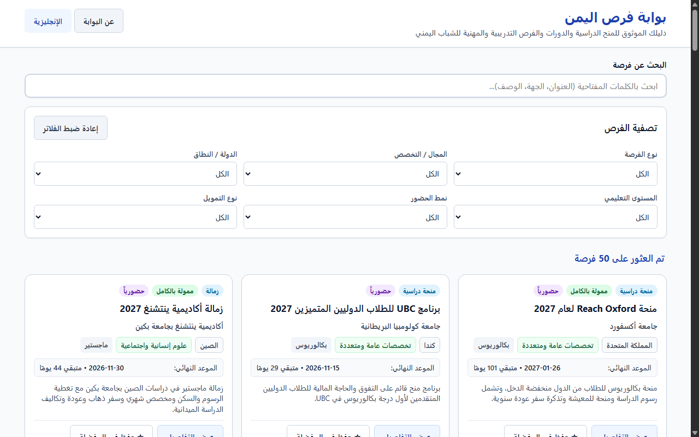
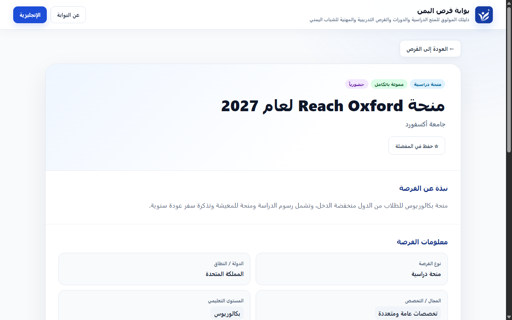
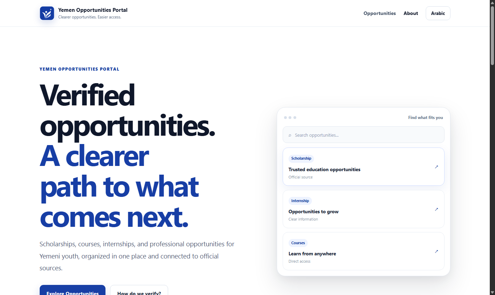

<div align="center">


# Yemen Opportunities Portal

<p align="center">
  <a href="https://github.com/xmohamedtariq/yemen-opportunities-portal">💻 <strong>GitHub Repository</strong></a>
  &nbsp;&nbsp; • &nbsp;&nbsp;
  <a href="https://xmohamedtariq.github.io/yemen-opportunities-portal/">🌐 <strong>Live Website</strong></a>
</p>


### Trusted opportunities. Clearer access. Built for Yemeni youth.

A bilingual platform for discovering scholarships, internships, courses, and educational opportunities from trusted official sources.

</div>

---

## Overview

**Yemen Opportunities Portal** helps Yemeni students and young people discover trusted educational opportunities through a clear, bilingual, and accessible experience.

Opportunity records are manually reviewed from official sources. The portal does not invent opportunities or rely on uncontrolled automated scraping.

## Key Features

- Arabic-first interface with full English support
- Correct RTL and LTR layouts
- 50 reviewed opportunity records
- Keyword search and filtering
- Dedicated opportunity detail pages
- Deadline status and days remaining
- Favorites stored locally in the browser
- Offline support using a Service Worker after the first successful online load
- Statistics dashboard for opportunity insights
- Suggest an Opportunity workflow with pending manual review
- Automated testing and documented security review
- Deployed publicly using GitHub Pages
- Secure links to official sources
- Responsive design tested at 360px
- Keyboard-friendly navigation
- No account required

## Screenshots

### Opportunities



### Opportunity Details



### About



## Data Integrity

Each production opportunity includes an official source URL and verification date.

**50 opportunities — 0 structural validation errors**

The project does not automatically invent, scrape, or silently modify opportunity data.

## Testing

Automated browser verification covers:

- Search and filtering
- Arabic / English switching
- RTL / LTR behavior
- Opportunity details
- Favorites persistence
- Deadline states
- Secure external links
- 360px responsive layout
- Keyboard focus
- Shared bilingual navigation
- Browser console health

**Current status: ALL TESTS PASSED**

Testing evidence is stored in `docs/testing/` and visual evidence in `docs/evidence/`.

## Technology

- HTML5
- CSS3
- Vanilla JavaScript
- JSON
- LocalStorage
- Chrome DevTools Protocol
- Node.js native APIs

No frontend framework or CDN dependency is required.

## Project Structure

```text
assets/     Brand assets and social icons
css/        Website styles
data/       Opportunity dataset and schema
docs/       Tasks, testing evidence, and screenshots
js/         Application logic
scripts/    Dataset validation tools
tests/      Automated browser tests
```

## العربية

### بوابة فرص اليمن

بوابة ثنائية اللغة تساعد الطلاب والشباب اليمني على اكتشاف المنح الدراسية والتدريبات والدورات والفرص التعليمية الموثوقة بطريقة واضحة وسهلة.

تعتمد البوابة على بيانات تمت مراجعتها يدويًا من المصادر الرسمية، مع توثيق رابط المصدر وتاريخ التحقق لكل فرصة.

تدعم البوابة البحث والتصفية، صفحات تفاصيل الفرص، المفضلة، متابعة المواعيد النهائية، والعربية والإنجليزية بشكل كامل.

## Creator

**Mohammed Tariq Al-Saqaf**  
AI Solutions Developer & Data Analyst

<p>
  <a href="https://github.com/xmohamedtariq">
    
  </a>
  &nbsp;&nbsp;&nbsp;
  <a href="https://www.linkedin.com/in/mohammed-tariq-3a1a0824a/">
    
  </a>
</p>

---

<div align="center">

**Built to make trusted opportunities easier to discover for Yemeni youth.**

</div>
